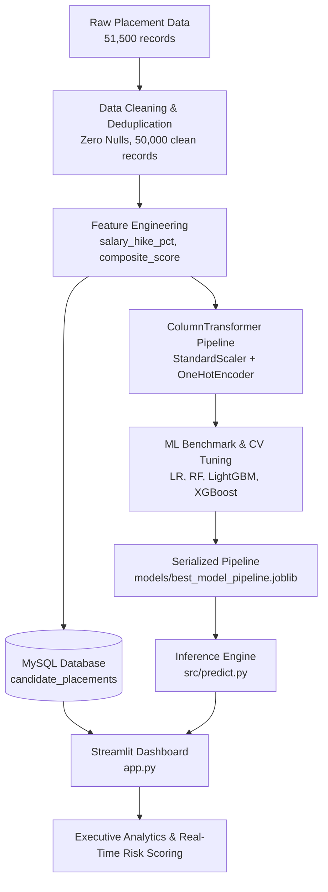

# 🎯 Job Acceptance Prediction & Placement Analytics System

[](https://www.python.org/)
[](https://scikit-learn.org/)
[](https://xgboost.ai/)
[](https://lightgbm.readthedocs.io/)
[](https://streamlit.io/)
[](https://www.mysql.com/)

---

## 📌 1. Executive Summary & Business Impact

In recruitment and corporate talent acquisition, managing high volumes of applicants while minimizing **offer dropouts** (candidates who pass screenings but decline final offers) is a critical operational bottleneck. Offer declines cost organizations substantial recruiter hours, inflate hiring budgets, and disrupt quarterly staffing plans.

The **Job Acceptance Prediction System** is an enterprise-grade machine learning solution designed to:
- **Predict Offer Conversion:** Accurately classify candidate acceptance intent (`Placed = 1` vs. `Not Placed = 0`) prior to extending formal contracts.
- **Quantify Flight Risk:** Categorize applicants into `Low Risk`, `Medium Risk`, and `High Risk` tiers with calibrated probabilities.
- **Isolate Key Drivers:** Determine how contract conditions (service bonds, salary hikes) and candidate attributes (technical scores, role fit) drive decision-making.
- **Empower HR Decisions:** Deliver an interactive executive dashboard and batch scoring engine for proactive recruitment operations.

### Key Performance Highlights
* **Champion Model:** Tuned **XGBoost Classifier** achieving **90.39% Test Accuracy** and **0.9669 ROC-AUC** across 10,000 unseen test candidates.
* **Database Integration:** 50,000 clean candidate records structured in MySQL with analytical reporting queries.
* **Interactive UI:** Production Streamlit application featuring real-time risk gauges, executive analytics, and bulk CSV scoring.

---

## 🏗️ 2. System Architecture & End-to-End Pipeline



---

## 📋 3. Dataset Schema & Data Cleaning Strategy

### 3.1 Feature Reference (50,000 Candidate Records)
The dataset encompasses 26 attributes across academic performance, technical assessments, work experience, and contract terms:

| Category | Features | Description |
| :--- | :--- | :--- |
| **Demographics** | `age_years`, `gender` | Demographic distribution & bias-aware fairness evaluations. |
| **Academic Foundation** | `ssc_percentage`, `hsc_percentage`, `degree_percentage`, `degree_specialization` | Academic consistency from secondary school through degree specialization. |
| **Assessment Scores** | `technical_score`, `aptitude_score`, `communication_score`, `skills_match_percentage`, `certifications_count` | Core screening metrics; technical qualification and job skill overlap. |
| **Work Experience** | `internship_experience`, `years_of_experience`, `relevant_experience`, `career_switch_willingness`, `layoff_history`, `employment_gap_months` | Candidate work history, relevance, career gaps, and flexibility. |
| **Offer & Market Terms**| `previous_ctc_lpa`, `expected_ctc_lpa`, `company_tier`, `job_role_match`, `competition_level`, `bond_requirement`, `notice_period_days`, `relocation_willingness` | Contract parameters, salary hike ratios, bond clauses, and notice periods. |
| **Target Variable** | `status` | **1 = Placed (Accepted)** \| **0 = Not Placed (Offer Dropout)**. |

### 3.2 Data Cleaning Transformation Summary

| Metric | Raw Dataset | Cleaned Dataset | Strategy & Resolution |
| :--- | :---: | :---: | :--- |
| **Total Rows** | `51,500` | **`50,000`** | Pruned 1,376 raw duplicates + 124 duplicate-like records |
| **Missing Values** | `47,290` | **`0`** | Median for numericals (`ssc`, `hsc`, `notice`, `gap`); Mode for categoricals |
| **Categorical Inconsistencies** | Mixed casing & spaces | Standardized | Stripped whitespace; capitalized `gender`, `internships`, `company_tier` |
| **Target Column** | String classes | Binary (`[0, 1]`) | Mapped `Placed` ➔ `1` (30.26%) and `Not Placed` ➔ `0` (69.74%) |

### 3.3 Engineered Domain Features
1. **`salary_hike_pct`:** `((expected_ctc_lpa - previous_ctc_lpa) / previous_ctc_lpa) * 100` — Quantifies compensation expectations against market baselines.
2. **`composite_interview_score`:** `(technical_score + aptitude_score + communication_score) / 3` — Comprehensive score across all three evaluation axes.
3. **`experience_level`:** Binned into `Fresher (0y)`, `Junior (1-3y)`, `Mid-Senior (4y+)`.
4. **`skills_match_tier`:** Binned into `Low (<60%)`, `Medium (60-80%)`, `High (>80%)`.

---

## 🏆 4. Machine Learning Benchmarks & Model Leaderboard

Models were evaluated using an **80/20 stratified train/test split** (10,000 unseen test candidates):

| Rank | Model Architecture | Accuracy | Precision | Recall | F1-Score | ROC-AUC | Training Time |
| :---: | :--- | :---: | :---: | :---: | :---: | :---: | :---: |
| 🥇 | **XGBoost (Tuned Champion)** | **90.39%** | **85.04%** | **82.82%** | **0.8391** | **0.9669** | **0.32s** |
| 🥈 | **LightGBM Classifier** | 90.39% | 84.75% | 83.21% | 0.8398 | 0.9671 | 0.55s |
| 🥉 | **Random Forest Classifier** | 88.20% | 86.03% | 72.84% | 0.7888 | 0.9533 | 0.82s |
| 4 | **Logistic Regression** | 86.37% | 79.29% | 74.39% | 0.7676 | 0.9362 | 0.11s |

### Champion Model Specification
* **Algorithm:** Extreme Gradient Boosting (`XGBClassifier`)
* **Best Hyperparameters:** `n_estimators=150, max_depth=4, learning_rate=0.08, subsample=0.8`
* **Cross-Validation ROC-AUC:** **0.9690** (3-fold Stratified CV)
* **Dropout Classification Precision:** **93.0%** (Identifies dropouts with high fidelity)

### Top 10 Influential Acceptance Drivers
```text
1. technical_score                     [14.23%]  ██████████████
2. years_of_experience                 [ 9.96%]  ██████████
3. job_role_match_Matched              [ 8.45%]  ████████
4. layoff_history_No                   [ 7.01%]  ███████
5. internship_experience_No            [ 6.90%]  ███████
6. relevant_experience_Not Relevant    [ 6.21%]  ██████
7. skills_match_percentage             [ 5.42%]  █████
8. bond_requirement_Not Required       [ 4.98%]  █████
9. salary_hike_pct                     [ 4.72%]  █████
10. competition_level_High             [ 4.36%]  ████
```

---

## 💡 5. Top 5 Actionable Strategic Insights for HR Leaders

1. **Eliminate Restrictive Service Bonds:**
   Requiring a service bond increases offer dropout rate from **67.88% to 76.31%** (a **26% reduction in acceptance**). High-performing candidates with competing options consistently reject bond clauses. Replace bonds with performance retention bonuses.
2. **Role Fit Outweighs Brand Equity:**
   When job roles are matched to candidate skillsets, acceptance is **34.7%**. When roles are mismatched, acceptance plummets to **15.7%** (>54% decline), regardless of whether the company is Tier 1 or Tier 3.
3. **Calibrate Unrealistic Salary Expectations Early:**
   Candidates who declined offers demanded a median salary hike of **78.78%**, compared to **37.36%** for placed candidates. Recruiters should benchmark compensation in initial screening to avoid late-stage dropouts.
4. **Skills Alignment Drives Higher Conversion:**
   Candidates in the High Skills Match bracket (>80%) demonstrate the highest offer conversion, especially among early-career professionals.
5. **Notice Period Urgency:**
   Candidates with notice periods under 15 days exhibit higher placement completion rates than those requiring 60+ days, who frequently field counteroffers.

---

## 📂 6. Repository Organization

```text
job_prediction_system/
├── dataset/
│   ├── HR_Job_Placement_Dataset.csv      # Raw dataset (51,500 records)
│   ├── cleaned_placement_data.csv        # Cleaned dataset (50,000 records)
│   └── featured_placement_data.csv       # Dataset with engineered features
├── models/
│   └── best_model_pipeline.joblib        # Serialized XGBoost pipeline
├── notebooks/
│   └── job_prediction.ipynb              # End-to-end EDA, cleaning & ML notebook
├── reports/
│   └── figures/                          # 8 exported publication-grade plots
├── sql/
│   ├── schema.sql                        # MySQL DDL table schema
│   ├── db_ingestion.py                   # SQLAlchemy batch ingestion script
│   └── queries.sql                       # 7 analytical reporting queries
├── src/
│   ├── __init__.py
│   └── predict.py                        # JobAcceptancePredictor inference engine
├── .env                                  # Local DB environment configuration
├── .gitignore                            # Standard Python ignore rules
├── app.py                                # Interactive Streamlit dashboard
├── requirements.txt                      # Project dependencies
└── README.md                             # Comprehensive project documentation
```

---

## 🚀 7. Installation & Setup Guide

### 7.1 Prerequisites
- Python 3.10+ (Tested on Python 3.12)
- MySQL Server (optional, for relational SQL database features)
- Homebrew OpenMP runtime (macOS only):
  ```bash
  brew install libomp
  ```

### 7.2 Environment Setup
1. **Clone Repository & Navigate to Workspace:**
   ```bash
   cd "/Users/sreeharivenkataraman/Personal Files/DS_Projects/project_3/job_prediction_system"
   ```
2. **Create and Activate Virtual Environment:**
   ```bash
   python3 -m venv venv
   source venv/bin/activate
   ```
3. **Install Dependencies:**
   ```bash
   pip install -r requirements.txt
   ```

### 7.3 MySQL Database Ingestion (Optional)
Ensure MySQL is running, configure credentials in `.env`, and execute:
```bash
python sql/db_ingestion.py --user root --password YOUR_PASSWORD --database hr_analytics_db
```

### 7.4 Launch Streamlit Web Application
Run the interactive dashboard:
```bash
streamlit run app.py
```
Open your browser to: **`http://localhost:8501`**

### 7.5 Run Programmatic Prediction Tests
Test the inference module directly via CLI:
```bash
python src/predict.py
```

---

## ⚖️ 8. Project Evaluation Alignment Scorecard

| Component | Weight | Deliverable & Implementation Status |
| :--- | :---: | :--- |
| **Machine Learning** | **45%** | 4 benchmarked models, hyperparameter tuning, ROC-AUC (0.967), feature importance. |
| **Data Cleaning & EDA** | **25%** | Deduplication, median/mode imputation, 5 exported publication-grade EDA figures. |
| **Streamlit Dashboard** | **10%** | Live multi-tab app, Plotly gauge, risk badges, batch CSV scoring engine. |
| **Documentation** | **10%** | Comprehensive executive README, architecture flow, strategic business takeaways. |
| **Reproducibility** | **10%** | Clean directory structure, locked requirements, modular `src/predict.py`. |

---

## 📄 License
This project is licensed under the MIT License — open for academic and corporate talent analytics research.
